# CliniqPay · Flow Atlas

Source snapshot: initial plan (nothing built yet) · 2026-11-08.

Plan a lightweight billing and cashier desk for small healthcare providers in India.

Open [the interactive atlas](./index.html) for diagrams, step details, source references, SVG export and printing.

## Index

1. [The whole product](#overview) — planned
2. [Build order](#roadmap) — planned
3. [Hospital enrollment](#enrollment) — delivered
4. [CliniqPay master administration](#platform-admin) — delivered
5. [Hospital setup](#setup) — delivered
6. [Quick billing](#billing) — delivered
7. [Payment collection](#payment) — delivered
8. [WhatsApp receipts](#receipts) — delivered
9. [Daily summary](#summary) — delivered
10. [How every feature is built](#quality-gates) — delivered
11. [Release](#release) — planned

## The whole product

Status: **planned** · Hospital enrollment, platform administration, billing and collections for healthcare providers in India.

Sources: none yet (planned).

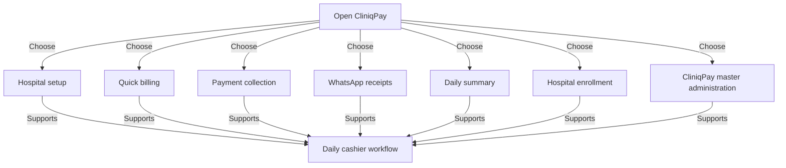

| Step | Behaviour |
| --- | --- |
| Open CliniqPay | Staff start at the cashier desk |
| Hospital setup | Open the hospital setup flow |
| Quick billing | Open the quick billing flow |
| Payment collection | Open the payment collection flow |
| WhatsApp receipts | Open the whatsapp receipts flow |
| Daily summary | Open the daily summary flow |
| Hospital enrollment | Open the hospital enrollment flow |
| CliniqPay master administration | Open the cliniqpay master administration flow |
| Daily cashier workflow | Bills, collections, receipts and summaries |

- Planned from requirement.md; integration and implementation decisions remain open.

## Build order

Status: **planned** · The order Loop builds the features in (meta.buildOrder).

Sources: none yet (planned).

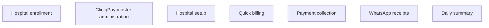

| Step | Behaviour |
| --- | --- |
| Hospital enrollment | Track: .loop/tracks/enrollment/spec.md |
| CliniqPay master administration | Track: .loop/tracks/platform-admin/spec.md |
| Hospital setup | Track: .loop/tracks/setup/spec.md |
| Quick billing | Track: .loop/tracks/billing/spec.md |
| Payment collection | Track: .loop/tracks/payment/spec.md |
| WhatsApp receipts | Track: .loop/tracks/receipts/spec.md |
| Daily summary | Track: .loop/tracks/summary/spec.md |

- npm run atlas:next always names the first map in this order that is not delivered. The release map comes last.

## Hospital enrollment

Status: **delivered** · Landing page hospital enrollment and status tracking.

Sources: [enrollment/views.py:7](../../enrollment/views.py), [enrollment/tests.py:6](../../enrollment/tests.py).

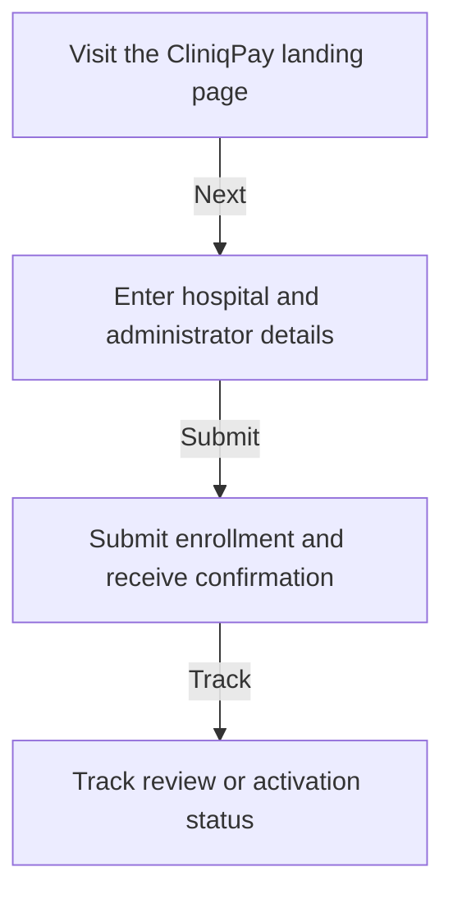

| Step | Behaviour |
| --- | --- |
| Visit the CliniqPay landing page | Hospital representative visits the landing page and initiates enrollment. |
| Enter hospital and administrator details | Form collects hospital name, city, state, contact phone, email, and admin name. |
| Submit enrollment and receive confirmation | Submission is validated, saved with status pending_review, and reference token issued. |
| Track review or activation status | Hospital checks activation status using their reference token or email. |

- Track: .loop/tracks/enrollment/spec.md

## CliniqPay master administration

Status: **delivered** · Review, approve, and activate enrolled hospital accounts.

Sources: [platform_admin/views.py:9](../../platform_admin/views.py), [platform_admin/tests.py:6](../../platform_admin/tests.py).

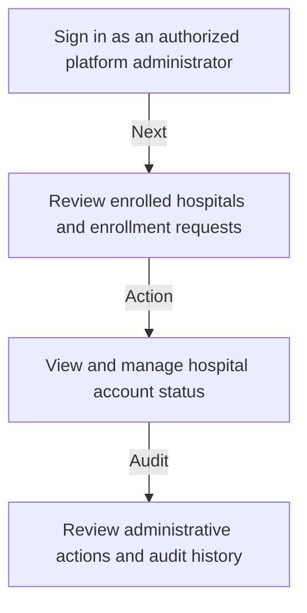

| Step | Behaviour |
| --- | --- |
| Sign in as an authorized platform administrator | Master administrator signs into the platform administration console. |
| Review enrolled hospitals and enrollment requests | List pending and active clinic registrations with contact and applicant details. |
| View and manage hospital account status | Approve request, issue 7-day trial, provision clinic workspace, or reject application. |
| Review administrative actions and audit history | Track who approved each clinic, timestamps, and audit history. |

- Track: .loop/tracks/platform-admin/spec.md

## Hospital setup

Status: **delivered** · Configure hospital details, tariffs, doctors, and payment settings.

Sources: [setup_hospital/views.py:16](../../setup_hospital/views.py), [setup_hospital/tests.py:7](../../setup_hospital/tests.py).

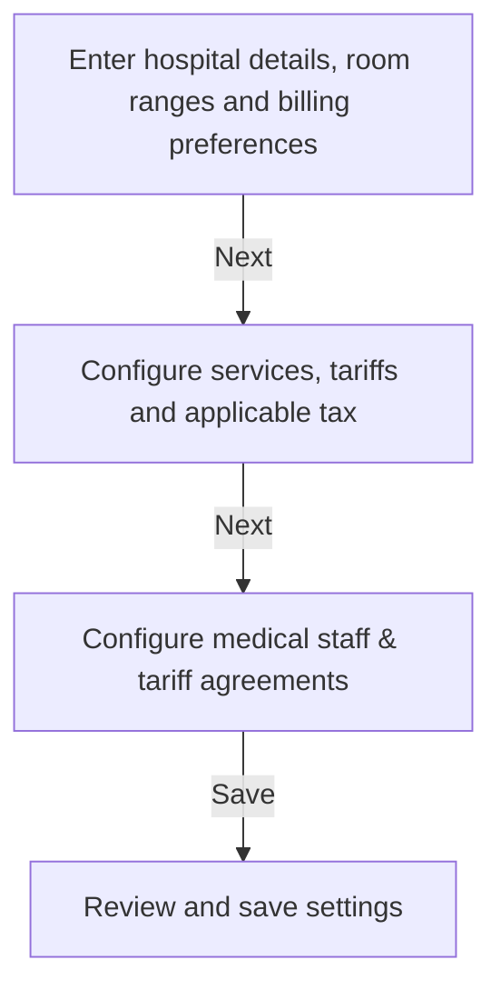

| Step | Behaviour |
| --- | --- |
| Enter hospital details, room ranges and billing preferences | Set hospital name, GSTIN, bed count, starting room number, validate zero-overlap room allocations, and 8 PM daily closing time. |
| Configure services, tariffs and applicable tax | Add or edit procedures (OPD Consultation, ECG, Room Rent) and tax rates. |
| Configure medical staff & tariff agreements | Add physicians with professional fee splits, clinical login credentials, and payment settings. |
| Review and save settings | Validate setup completeness and prepare cashier desk for live billing. |

- Track: .loop/tracks/setup/spec.md

## Quick billing

Status: **delivered** · 10-second OPD and IPD billing with serial auto-increment, dedicated Pharmacist terminal with mandatory batch and expiry tracking, inward batch CSV import, and storage rack coordinates.

Sources: [billing/views.py:10](../../billing/views.py), [billing/tests.py:8](../../billing/tests.py).

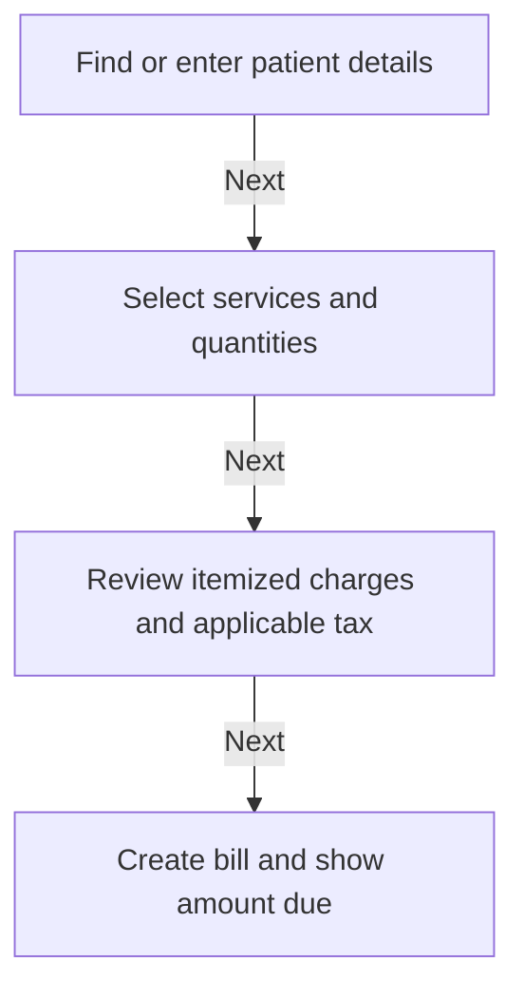

| Step | Behaviour |
| --- | --- |
| Find or enter patient details | Define validation, failure and recovery before implementation. |
| Select services and quantities | Define validation, failure and recovery before implementation. |
| Review itemized charges and applicable tax | Define validation, failure and recovery before implementation. |
| Create bill and show amount due | Define validation, failure and recovery before implementation. |

- Track: .loop/tracks/billing/spec.md

## Payment collection

Status: **delivered** · Collect payment via exact-amount dynamic UPI QR or verified cash.

Sources: [payments/views.py:12](../../payments/views.py), [payments/tests.py:9](../../payments/tests.py).

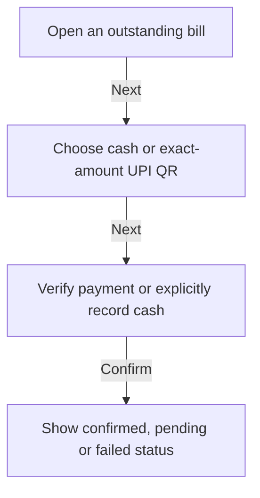

| Step | Behaviour |
| --- | --- |
| Open an outstanding bill | Open the unpaid invoice to collect settlement. |
| Choose cash or exact-amount UPI QR | Present on-screen dynamic UPI QR with embedded amount or select Cash entry. |
| Verify payment or explicitly record cash | Receive automated UPI webhook match or record cashier-verified physical cash. |
| Show confirmed, pending or failed status | Mark bill paid, generate receipt token, and unlock WhatsApp dispatch. |

- Track: .loop/tracks/payment/spec.md

## WhatsApp receipts

Status: **delivered** · Planned whatsapp receipts workflow.

Sources: [receipts/views.py:10](../../receipts/views.py).

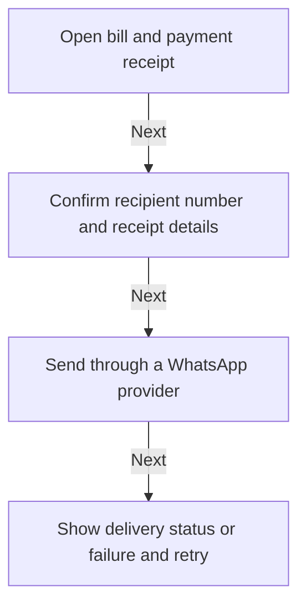

| Step | Behaviour |
| --- | --- |
| Open bill and payment receipt | Define validation, failure and recovery before implementation. |
| Confirm recipient number and receipt details | Define validation, failure and recovery before implementation. |
| Send through a WhatsApp provider | Define validation, failure and recovery before implementation. |
| Show delivery status or failure and retry | Define validation, failure and recovery before implementation. |

- Track: .loop/tracks/receipts/spec.md

## Daily summary

Status: **delivered** · Daily 8 PM collections, doctor shares & reconciliation report.

Sources: [summary/views.py:12](../../summary/views.py).

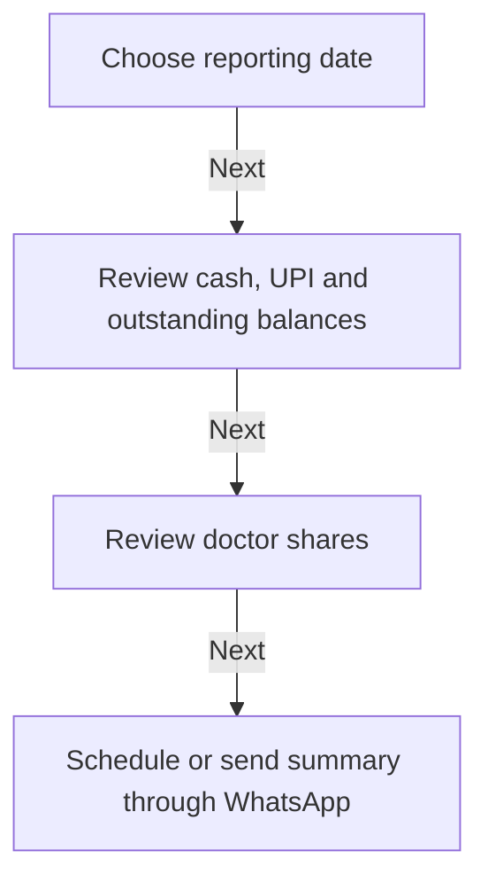

| Step | Behaviour |
| --- | --- |
| Choose reporting date | Define validation, failure and recovery before implementation. |
| Review cash, UPI and outstanding balances | Define validation, failure and recovery before implementation. |
| Review doctor shares | Define validation, failure and recovery before implementation. |
| Schedule or send summary through WhatsApp | Define validation, failure and recovery before implementation. |

- Track: .loop/tracks/summary/spec.md

## How every feature is built

Status: **delivered** · The atlas-first checkpoint loop this project follows.

Sources: [AGENTS.md:1](../../AGENTS.md), [.loop/workflow.md:1](../../.loop/workflow.md), [.loop/platform.md:1](../../.loop/platform.md).

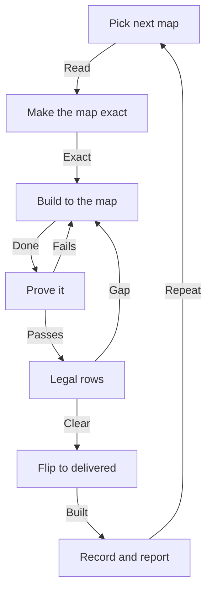

| Step | Behaviour |
| --- | --- |
| Pick next map | npm run atlas:next names the next planned map and its track. |
| Make the map exact | Steps, branches, defaults, failure paths. Status: building. |
| Build to the map | Smallest coherent change, all languages, version bump. Platform: Django web application for desktop and tablet browsers. |
| Prove it | Behaviour tests (Django tests or pytest once configured), npm run atlas, phone/tablet and desktop browser checks once configured. Proof ladder in .loop/platform.md. |
| Legal rows | Update .loop/legal-checklist.md rows this change touches (data, cookies, APIs, packages, assets, AI content, payments, advice, claims). Rules: Loop/LEGAL-CHECKLIST.md. |
| Flip to delivered | Add source refs (file:line). The build refuses delivered without source. |
| Record and report | Track, fix queue, HANDOFF CURRENT RESUME, commit, plain-words report. |

- Defined by AGENTS.md, .loop/workflow.md and .loop/platform.md (generated by Loop).

## Release

Status: **planned** · How CliniqPay reaches users on Django web application for desktop and tablet browsers.

Sources: none yet (planned).

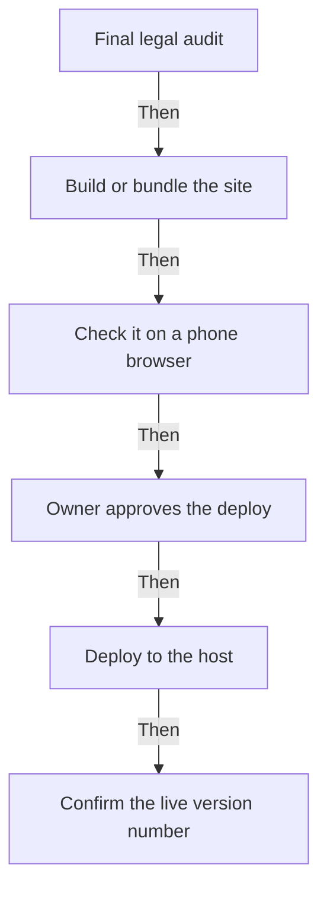

| Step | Behaviour |
| --- | --- |
| Final legal audit | Legal check 20: recheck all 20 rows in .loop/legal-checklist.md, flag lawyer items, owner approves legal pages. Rules: Loop/LEGAL-CHECKLIST.md. |
| Build or bundle the site | Release step: Build or bundle the site. Owner approval gates in Loop/loop.md apply. |
| Check it on a phone browser | Release step: Check it on a phone browser. Owner approval gates in Loop/loop.md apply. |
| Owner approves the deploy | Release step: Owner approves the deploy. Owner approval gates in Loop/loop.md apply. |
| Deploy to the host | Release step: Deploy to the host. Owner approval gates in Loop/loop.md apply. |
| Confirm the live version number | Release step: Confirm the live version number. Owner approval gates in Loop/loop.md apply. |

- Built last, after the first-release features. Track: .loop/tracks/release/spec.md

## Coverage and limitations

Planned maps describe intended behaviour and are not delivered. Delivered maps are source-reviewed; they are not proof of runtime, device or performance behaviour unless the notes say which evidence exists.
